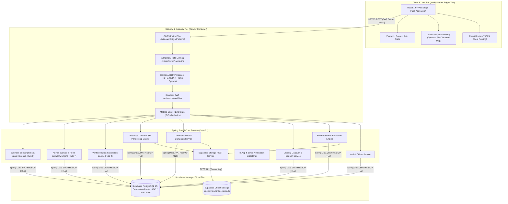
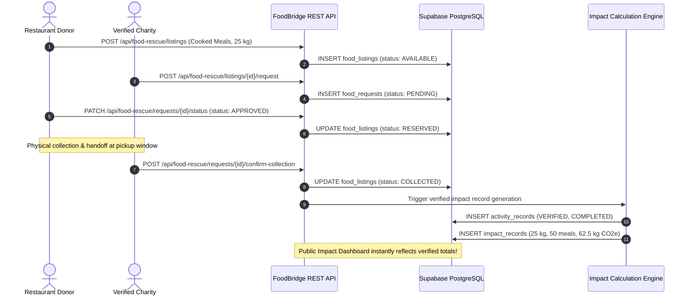
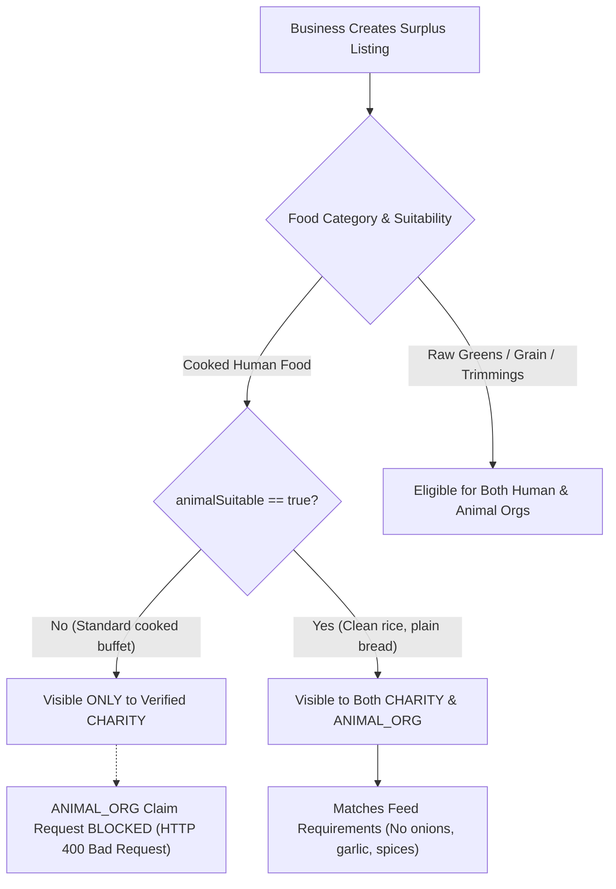
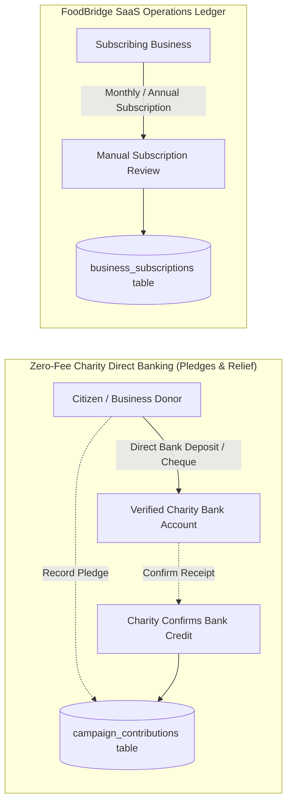
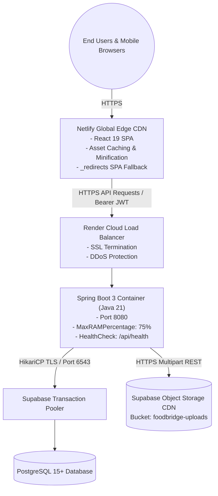

# FoodBridge System Architecture & Technical Specifications

> **Platform:** FoodBridge — Community Sustainability & Food Rescue Platform for Sri Lanka  
> **Engineering Organization:** Team EcoConnect  
> **Deployment Targets:** Netlify (Frontend), Render (Backend), Supabase (PostgreSQL + Storage)  

---

## 1. High-Level Architecture Diagram



---

## 2. Core Architectural Principles & Enforced Platform Rules

### Rule 1: Role-Based Access Control (RBAC) on Every Endpoint
Every API route is guarded by Spring Security filter chains and `@PreAuthorize` method annotations:
- `ADMIN`: Platform moderation, verification queue, subscription billing, audit logs.
- `RESTAURANT`: Cooked surplus listings, collection approvals, CSR partnerships.
- `GROCERY`: Surplus grocery offers, coupon redemption, campaign sponsorships.
- `CHARITY`: Surplus food requests, community campaigns, contribution confirmations.
- `ANIMAL_ORG`: Animal feed requests, feeding location management, sanctuary nutrition drives.
- `USER`: Citizens and volunteers discovering deals, volunteering, and reserving coupons.

### Rule 2: Admin-Verified Publishers
Unverified businesses and non-profits cannot publish public food listings or launch campaigns. Publishers submit registration documentation (`BRC`, `NGO`, or `Animal Welfare Registry`) which enters an administrative approval queue.

### Rule 3: Campaign Moderation Gate
Fundraising and relief campaigns submitted by verified charities remain in `PENDING_APPROVAL` status until reviewed by an administrator. Photos and administrative division verifications are mandatory.

### Rule 4: Verified Completed Impact Accounting
Platform impact counters (`food_weight_kg`, `meals_rescued`, `co2_savings_kg`, `people_fed`, `animals_fed`) never increment on initial listing or claim. They only increment upon explicit physical handoff confirmation (`status: COMPLETED` and `verification_status: VERIFIED`).



---

## 3. Food Suitability & Separation Rules Engine (Rule 7)

To eliminate food safety risks and respect cultural and dietary guidelines, FoodBridge implements a strict suitability engine:



---

## 4. Financial Ledger Segregation Architecture (Rule 8)

FoodBridge maintains complete architectural separation between philanthropic community funds and platform software revenue:



- **Philanthropic Ledger (`campaign_contributions`):** Zero platform transaction fees, zero intermediary holding accounts. Pledges are verified directly against bank statements by receiving charities.
- **SaaS Platform Revenue (`business_subscriptions`):** Tracks commercial business tiers (`FREE`, `PROMOTION`, `PREMIUM`) with feature gating and manual admin activation.

---

## 5. Network Topology & Production Deployment Infrastructure



---

## 6. Monorepo Directory Organization

```text
FoodBridge/
├── backend/                             # Java Spring Boot 3 REST API
│   ├── src/main/java/com/ecoconnect/foodbridge/
│   │   ├── config/                      # Security (RBAC), CORS, OpenAPI, AdminSeeder
│   │   ├── controller/                  # 15 REST Controllers
│   │   ├── dto/                         # Typed request/response records & validation
│   │   ├── exception/                   # Global exception handler (@ControllerAdvice)
│   │   ├── model/                       # JPA entities & enumerations
│   │   ├── repository/                  # Spring Data JPA repositories (27 interfaces)
│   │   ├── security/                    # JWT filter, Rate limiting, Upload security
│   │   └── service/                     # Business logic & relational seeders
│   ├── src/main/resources/
│   │   ├── application.yml              # Supabase PostgreSQL production config
│   │   ├── application-local.yml        # Offline H2 in-memory profile
│   │   └── db/
│   │       ├── migration/               # Flyway SQL migrations (V1 to V12)
│   │       └── seed_demo_data_kandy.sql # Standalone Kandy SQL demo script
│   ├── Dockerfile                       # Multi-stage production container build
│   └── pom.xml                          # Maven build dependencies & plugins
├── frontend/                            # React 19 + Vite SPA
│   ├── public/
│   │   └── _redirects                   # Netlify SPA routing fallback
│   ├── src/
│   │   ├── api/client.js                # Centralized Axios API client & interceptors
│   │   ├── components/                  # Navigation, Modals, Feed cards, Notifications
│   │   ├── context/                     # AuthContext, NotificationContext
│   │   └── pages/                       # Public views & 6 Role-specific dashboards
│   ├── netlify.toml                     # Standalone Netlify configuration
│   └── package.json                     # Dependencies & scripts
├── docs/                                # Technical specifications
│   ├── API_DOCUMENTATION.md             # REST API specifications
│   ├── openapi.yaml                     # OpenAPI 3.0 specification
│   ├── ARCHITECTURE.md                  # System architecture & diagrams
│   ├── ROLES_AND_PERMISSIONS.md         # RBAC matrix
│   ├── SECURITY_CHECKLIST.md            # Security audit report
│   ├── USER_GUIDES.md                   # User guide per role
│   ├── DEMO_SCRIPT.md                   # 5-minute continuous walkthrough script
│   └── KANDY_PILOT_PLAN.md              # Regional rollout plan & metrics
├── DEPLOYMENT.md                        # Netlify, Render & Supabase setup guide
├── netlify.toml                         # Root monorepo Netlify configuration
├── render.yaml                          # Render Blueprint Infrastructure-as-Code
└── README.md                            # Comprehensive platform overview
```
