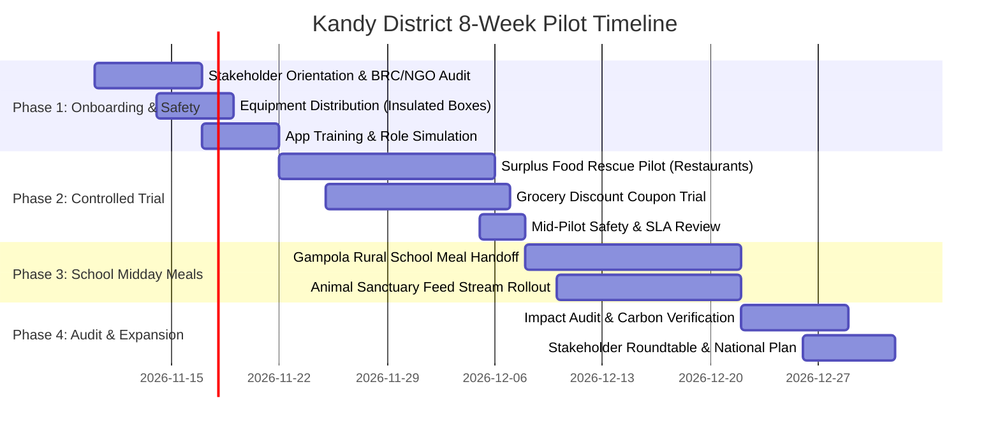

# FoodBridge Kandy District Pilot Implementation Plan

> **Pilot Title:** Central Province Zero-Waste Food Security & Relief Initiative  
> **Region:** Kandy Municipality, Peradeniya, Katugastota, Digana, and Gampola Rural Division  
> **Duration:** 8 Weeks (Two 4-Week Operating Cycles)  
> **Managing Body:** Team EcoConnect, in partnership with Central Province Municipal & Social Services Authorities  

---

## 1. Executive Summary & Pilot Scope

The Kandy District Pilot serves as the initial real-world proving ground for the FoodBridge platform. By uniting urban hospitality donors, peri-urban grocers, verified non-profit charities, rural primary schools, and an animal rescue sanctuary, this pilot validates platform reliability, food safety compliance, and community impact under real-world operating conditions.

### Stakeholder Cohort

| Stakeholder Category | Organization Name | Location | Capacity / Target Role |
| :--- | :--- | :--- | :--- |
| **Restaurant Donor 1** | *The Royal Kandyan Resto* | Dalada Veediya, Kandy | 20–30 kg daily surplus cooked buffet meals |
| **Restaurant Donor 2** | *Devon Heritage Bakery & Tea Lounge* | Dalada Veediya, Kandy | 15–20 kg daily day-end baked goods & rolls |
| **Restaurant Donor 3** | *Peradeniya Riverside Curry Pot* | Peradeniya Road | 15–25 kg packaged lunch parcels |
| **Restaurant Donor 4** | *Kandy Hillside Spice Kitchen* | Hanthana Road, Kandy | 20 kg bulk vegetable curries & grains |
| **Grocery Partner 1** | *Kandy Central Green Grocers* | Peradeniya Market Junction | 50% discount produce bundles & animal greens |
| **Grocery Partner 2** | *Cargills Food City Katugastota* | Kurunegala Road, Katugastota | Dairy, bakery & pantry coupon redemption |
| **Grocery Partner 3** | *Digana Valley Fresh Harvest Super* | Victoria Highway, Digana | Bulk farm produce & safe grain trimmings |
| **Charity Partner 1** | *Kandy Community Relief Foundation* | Ampitiya Road, Kandy | Urban meal distribution hub (450 people capacity) |
| **Charity Partner 2** | *Central Hills Hope & Nutrition Trust* | Temple Road, Gampola | Upcountry estate & rural distribution network |
| **Pilot Beneficiary School** | *Gampola Rural Primary School* | Gampola Division | 200 disadvantaged primary students (Midday meal program) |
| **Animal Welfare Org** | *Kandy Street Animal Care & Welfare Society* | Kundasale Animal Sanctuary | 180 sanctuary animals + 3 feeding locations |

---

## 2. Phased 8-Week Rollout Timeline

### Phase 1: Onboarding, Verification & Food Safety (Weeks 1–2)
- Inspect and verify Business Registration Certificates (`BRC`) and NGO credentials.
- Issue standardized, food-grade thermal containers and temperature log sheets to collection drivers.
- Conduct in-person Food Safety SOP briefings for restaurant culinary leads and charity coordinators.
- Seed baseline accounts and verify geofenced GPS map pins.

### Phase 2: Controlled Surplus Rescue & Retail Coupon Trial (Weeks 3–4)
- Initiate live daily food surplus listings from *The Royal Kandyan Resto* and *Peradeniya Riverside Curry Pot*.
- Enforce strict 4-hour collection windows ($14:00 - 17:00$ local time).
- Launch 20 initial discount grocery bundles across Katugastota and Peradeniya; test cashier redemption workflow.
- First weekly audit meeting to address turnaround delays or communication bottlenecks.

### Phase 3: Rural School Midday Meals & Animal Sanctuary Integration (Weeks 5–6)
- Launch the *Gampola Rural Primary School* midday meal sponsorship: *Devon Heritage Bakery* delivers 500 fortified buns weekly in coordination with *Central Hills Hope & Nutrition Trust*.
- Connect *Digana Valley Fresh Harvest Super* surplus vegetable trimmings and bread scraps to *Kandy Street Animal Care & Welfare Society*.
- Enforce **Rule 7** suitability separation checklists on every animal feed dispatch.

### Phase 4: Comprehensive Impact Audit & Scale-Up Blueprint (Weeks 7–8)
- Verify data fidelity between physical delivery receipts, charity bank statements, and automated platform impact metrics.
- Calculate total kilograms rescued, meal equivalents delivered, and municipal landfill waste diverted.
- Host the **Central Province Sustainability Roundtable** in Kandy to present findings to municipal councils, the Ministry of Health, and potential CSR corporate sponsors.

---

## 3. Key Performance Indicators (KPIs) & Target Metrics

| Metric / KPI | Baseline (Pre-Pilot) | 8-Week Pilot Target | Measurement & Verification Mechanism |
| :--- | :---: | :---: | :--- |
| **Surplus Food Rescued** | $0\text{ kg}$ | $\ge 2,500\text{ kg}$ | Scale weights logged by donor & recipient at handoff |
| **Nutritious Meals Served** | $0$ | $\ge 5,000\text{ meals}$ | Verified `ImpactRecord` table ($1\text{ kg} = 2\text{ meals}$) |
| **Greenhouse Gas Emissions Prevented** | $0$ | $\ge 6,250\text{ kg } CO_2e$ | Calculated at $2.5\text{ kg } CO_2e$ per kg food rescued |
| **School Children Fed (Weekly)** | $0$ | $200\text{ students}$ | School principal attendance logs & meal registers |
| **Shelter Animals Fed** | $0$ | $\ge 180\text{ animals}$ | Daily shelter feed logs at Kundasale Sanctuary |
| **Retail Grocery Waste Reduction** | $0\%$ | $35\% - 45\%$ | Grocer shrinkage audits before & after discount coupons |
| **Consumer Grocery Cost Savings** | Rs. 0 | $\ge\text{Rs. } 350,000$ | Difference between original & discounted grocery totals |
| **Collection SLA Compliance** | N/A | $\ge 95\%$ | Claims collected within designated pickup window |
| **Food Safety Incidents** | N/A | **$0$ Incidents** | Zero spoilage, zero customer/beneficiary health complaints |
| **Volunteer Service Hours** | $0$ | $\ge 120\text{ hours}$ | Authenticated hours logged via `VolunteerParticipation` |

---

## 4. Food Safety & Standard Operating Procedures (SOPs)

### Prepared Cooked Food (Human Consumption)
1. **Temperature Thresholds:**
   - Hot food must be held at or above $60^\circ\text{C}$ prior to pickup, or cooled to below $5^\circ\text{C}$ within 2 hours.
   - Temperature probe measurements must be logged on the container label.
2. **Maximum Window of Consumption:**
   - Cooked meals must be collected within 3 hours of listing and consumed within 4 hours of pickup.
3. **Packaging Requirements:**
   - Food-grade, sterile, sealed containers only. Open platters or uncovered trays are prohibited from transit.

### Animal Feed Suitability (Rule 7 Separation)
1. **Prohibited Ingredients (Toxicity Blacklist):**
   - Strictly NO onions, shallots, garlic, leeks, chives, grapes, raisins, chocolate, caffeine, or cooked poultry bones that can splinter.
   - Spicy gravies, curries, and chili-laden sauces are disqualified from animal welfare feed.
2. **Approved Feed Streams:**
   - Plain cooked white/red rice, unseasoned fish or meat scraps, day-end plain bread ends, carrot tops, cabbage leaves, pumpkin rinds, and safe grains.

---

## 5. Risk Assessment & Mitigation Matrix

| Identified Risk | Severity | Likelihood | Mitigation Strategy |
| :--- | :---: | :---: | :--- |
| **Traffic / Transit Delay in Kandy** | Medium | High | Require 60-minute buffer windows; utilize local area volunteers residing within 3 km of donor kitchens. |
| **Charity No-Show for Food Pickup** | High | Low | If unclaimed 60 minutes before window expiration, automatic SMS alert escalates to backup charity network. |
| **Mislabeling of Animal vs. Human Food** | Critical | Very Low | Enforce explicit checkbox confirmation and automatic keyword screening (`onion`, `curry`, `chili`) on animal feed listings. |
| **Disputed Pledges / Financial Claims** | Medium | Low | Zero platform cash handling (Rule 8); charities must cross-reference official bank statements before clicking **Confirm Receipt**. |
| **Cashier Confusion with Digital Coupons** | Low | Medium | 1-page counter laminated cheat-sheet provided to grocers with 13-character code redemption instructions. |

---

## 6. Pilot Governance & Review Cadence

- **Weekly Operations Sync (Every Monday 10:00 AM):** Review weekly rescued tonnage, pickup timeliness, and active campaign pledges.
- **Bi-Weekly Food Safety Audit:** Random inspections of collection vehicles and temperature logs by designated safety lead.
- **Final Pilot Review & Scale-Up Report:** Published at Week 8 with audited statistics for national rollout to Colombo, Galle, and Jaffna.

