# FoodBridge Entity-Relationship (ER) Diagram

**Team:** EcoConnect (Sri Lanka)  
**Database:** Supabase PostgreSQL  
**Migration:** Flyway V1  

This diagram models the 19 core tables, primary/foreign keys, and relational cardinalities supporting FoodBridge's community sustainability workflows and 9 non-negotiable platform rules.

```mermaid
erDiagram
    USERS ||--o| BUSINESSES : "operates (RESTAURANT/GROCERY)"
    USERS ||--o| CHARITIES : "operates (CHARITY)"
    USERS ||--o| ANIMAL_ORGANIZATIONS : "operates (ANIMAL_ORG)"
    USERS ||--o| VOLUNTEERS : "registers as"
    USERS ||--o{ ACTIVITY_RECORDS : "performs"
    USERS ||--o{ NOTIFICATIONS : "receives"
    USERS ||--o{ AUDIT_LOGS : "triggers"
    USERS ||--o{ CAMPAIGN_CONTRIBUTIONS : "contributes/pledges"

    BUSINESSES ||--o{ FOOD_LISTINGS : "publishes (Rule 2: Verified only)"
    BUSINESSES ||--o{ GROCERY_OFFERS : "publishes discounted"
    BUSINESSES ||--o{ COUPONS : "offers"
    BUSINESSES ||--o{ PARTNERSHIPS : "forms"
    BUSINESSES ||--o{ PROMOTIONS : "sponsors (Rule 8: Platform revenue)"
    BUSINESSES ||--o{ SUBSCRIPTIONS : "subscribes (Rule 8: Platform revenue)"

    FOOD_LISTINGS ||--o{ FOOD_REQUESTS : "receives claims"
    FOOD_LISTINGS ||--o{ ACTIVITY_RECORDS : "linked rescue activity"

    CHARITIES ||--o{ FOOD_REQUESTS : "claims human edible food"
    CHARITIES ||--o{ CAMPAIGNS : "organizes (Rule 3: Admin approved)"
    CHARITIES ||--o{ PARTNERSHIPS : "partners with business"

    ANIMAL_ORGANIZATIONS ||--o{ FOOD_REQUESTS : "claims animal feed"
    ANIMAL_ORGANIZATIONS ||--o{ CAMPAIGNS : "organizes (Rule 3: Admin approved)"
    ANIMAL_ORGANIZATIONS ||--o{ ANIMAL_LOCATIONS : "manages feeding zone"
    ANIMAL_ORGANIZATIONS ||--o{ PARTNERSHIPS : "partners with business"

    CAMPAIGNS ||--o{ CAMPAIGN_CONTRIBUTIONS : "receives pledges (Rule 5: No payment)"
    CAMPAIGNS ||--o{ ACTIVITY_RECORDS : "distribution activity"

    ACTIVITY_RECORDS ||--o| IMPACT_RECORDS : "qualifies (Rule 4: Verified & Completed only)"

    USERS {
        uuid id PK
        string email UK
        string password_hash
        string full_name
        string phone_number
        string role "ADMIN, RESTAURANT, GROCERY, CHARITY, ANIMAL_ORG, USER"
        boolean is_active
        datetime created_at
        datetime updated_at
    }

    BUSINESSES {
        uuid id PK
        uuid user_id FK "UK"
        string business_name
        string business_type "RESTAURANT, GROCERY"
        string registration_number UK
        string address_line1
        string city
        string district
        decimal latitude
        decimal longitude
        string verification_status "PENDING, VERIFIED, REJECTED, SUSPENDED"
        uuid verified_by FK
        datetime verified_at
    }

    CHARITIES {
        uuid id PK
        uuid user_id FK "UK"
        string charity_name
        string registration_number UK
        string address_line1
        string city
        string district
        decimal latitude
        decimal longitude
        int capacity_people
        string verification_status "PENDING, VERIFIED, REJECTED, SUSPENDED"
        uuid verified_by FK
        datetime verified_at
    }

    ANIMAL_ORGANIZATIONS {
        uuid id PK
        uuid user_id FK "UK"
        string organization_name
        string registration_number UK
        string animal_types
        int shelter_capacity
        string address_line1
        string city
        string district
        decimal latitude
        decimal longitude
        string verification_status "PENDING, VERIFIED, REJECTED, SUSPENDED"
        uuid verified_by FK
        datetime verified_at
    }

    FOOD_LISTINGS {
        uuid id PK
        uuid business_id FK
        string title
        string food_category
        string suitability_type "HUMAN_CONSUMPTION, ANIMAL_FEED (Rule 7)"
        decimal quantity
        string unit
        boolean perishable
        datetime expiry_date
        string status "AVAILABLE, RESERVED, COLLECTED, EXPIRED, CANCELLED"
        datetime pickup_start
        datetime pickup_end
        string pickup_address
        decimal latitude
        decimal longitude
    }

    FOOD_REQUESTS {
        uuid id PK
        uuid listing_id FK
        string requester_type "CHARITY, ANIMAL_ORG"
        uuid charity_id FK
        uuid animal_org_id FK
        decimal quantity_requested
        string status "PENDING, ACCEPTED, REJECTED, COLLECTED, CANCELLED"
        uuid volunteer_id FK
        datetime completed_at
    }

    GROCERY_OFFERS {
        uuid id PK
        uuid business_id FK
        string title
        decimal original_price
        decimal discounted_price
        string currency
        int available_quantity
        datetime expiry_date
        string status "AVAILABLE, SOLD_OUT, EXPIRED, CANCELLED"
    }

    COUPONS {
        uuid id PK
        uuid business_id FK
        string code UK
        decimal discount_percentage
        decimal discount_amount
        decimal min_purchase_amount
        datetime valid_from
        datetime valid_until
        int max_uses
        int used_count
        boolean is_active
    }

    CAMPAIGNS {
        uuid id PK
        string organizer_type "CHARITY, ANIMAL_ORG"
        uuid charity_id FK
        uuid animal_org_id FK
        string title
        text description
        decimal target_food_amount_kg
        decimal target_fund_amount
        decimal raised_fund_amount
        date start_date
        date end_date
        string status "PENDING_APPROVAL, APPROVED, REJECTED, ACTIVE, COMPLETED (Rule 3)"
        uuid approved_by FK
        datetime approved_at
        string district
        decimal latitude
        decimal longitude
    }

    PARTNERSHIPS {
        uuid id PK
        uuid business_id FK
        string partner_type "CHARITY, ANIMAL_ORG"
        uuid charity_id FK
        uuid animal_org_id FK
        string status "PROPOSED, ACCEPTED, REJECTED, TERMINATED"
        date start_date
        date end_date
    }

    CAMPAIGN_CONTRIBUTIONS {
        uuid id PK
        uuid campaign_id FK
        uuid contributor_user_id FK
        string contributor_name
        string contribution_type "MONETARY_PLEDGE, FOOD_ITEMS, EQUIPMENT, OTHER"
        decimal monetary_amount
        decimal food_amount_kg
        string status "PENDING_CONFIRMATION, CONFIRMED, REJECTED, CANCELLED (Rule 5)"
        uuid confirmed_by FK
        datetime confirmed_at
    }

    VOLUNTEERS {
        uuid id PK
        uuid user_id FK "UK"
        string skills
        string vehicle_type
        string availability_status "AVAILABLE, BUSY, INACTIVE"
        decimal current_latitude
        decimal current_longitude
        string preferred_districts
        string verification_status "PENDING, VERIFIED, REJECTED"
        int total_tasks_completed
    }

    ANIMAL_LOCATIONS {
        uuid id PK
        uuid animal_org_id FK
        uuid reported_by_user_id FK
        string location_name
        string animal_type
        int estimated_count
        string feeding_routine
        decimal latitude
        decimal longitude
        string district
        boolean is_active
    }

    ACTIVITY_RECORDS {
        uuid id PK
        string activity_type "FOOD_RESCUE, CAMPAIGN_DISTRIBUTION, ANIMAL_FEEDING"
        uuid related_listing_id FK
        uuid related_campaign_id FK
        uuid performed_by_user_id FK
        uuid verified_by_user_id FK
        string status "PENDING, IN_PROGRESS, VERIFIED, COMPLETED, REJECTED (Rule 4)"
        datetime completion_timestamp
    }

    PROMOTIONS {
        uuid id PK
        uuid business_id FK
        string title
        string banner_url
        datetime start_date
        datetime end_date
        decimal cost_lkr
        string payment_status "PENDING, PAID, FAILED, REFUNDED"
        boolean is_active
    }

    SUBSCRIPTIONS {
        uuid id PK
        uuid business_id FK
        string plan_name
        string billing_cycle "MONTHLY, ANNUAL"
        decimal amount_lkr
        datetime start_date
        datetime end_date
        string status "ACTIVE, PAST_DUE, CANCELLED, EXPIRED"
    }

    IMPACT_RECORDS {
        uuid id PK
        uuid activity_record_id FK "UK (Rule 4 prerequisite)"
        int meals_rescued
        decimal food_weight_kg
        decimal co2_savings_kg
        int people_fed
        int animals_fed
        datetime calculated_at
    }

    NOTIFICATIONS {
        uuid id PK
        uuid user_id FK
        string title
        text message
        string type
        boolean is_read
        uuid reference_id
        string reference_type
        datetime created_at
    }

    AUDIT_LOGS {
        uuid id PK
        uuid user_id FK
        string action
        string entity_name
        uuid entity_id
        string ip_address
        text details
        datetime created_at
    }
```

---

## Relational Rule Highlights

1. **Rule 2 (Admin Verification):** `businesses`, `charities`, and `animal_organizations` contain `verification_status`, `verified_by`, and `verified_at` columns. Only records with `verification_status = 'VERIFIED'` can create active `food_listings` or `campaigns`.
2. **Rule 3 (Campaign Approval):** `campaigns.status` defaults to `PENDING_APPROVAL`. Admin approval is tracked with `approved_by` and `approved_at`.
3. **Rule 4 (Impact Accounting):** `impact_records` has a 1-to-1 relationship with `activity_records` (`activity_record_id UNIQUE NOT NULL`). Impact records are generated only when the parent activity is both `status = 'VERIFIED'` and `status = 'COMPLETED'`.
4. **Rule 5 & 8 (No Payment Processing & Revenue Separation):** `campaign_contributions` tracks pledges confirmed by charities (`confirmed_by`, `status = 'CONFIRMED'`), without payment gateway credentials. FoodBridge platform operational revenue is isolated strictly in `subscriptions` and `promotions`.
5. **Rule 6 (Privacy):** Sensitive beneficiary information is not exposed; location coordinates are coarse and private addresses are masked for vulnerable users.
6. **Rule 7 (Food Suitability Separation):** `food_listings.suitability_type` enforces either `HUMAN_CONSUMPTION` or `ANIMAL_FEED`. Charities can only claim human food, while animal organizations claim animal feed.

